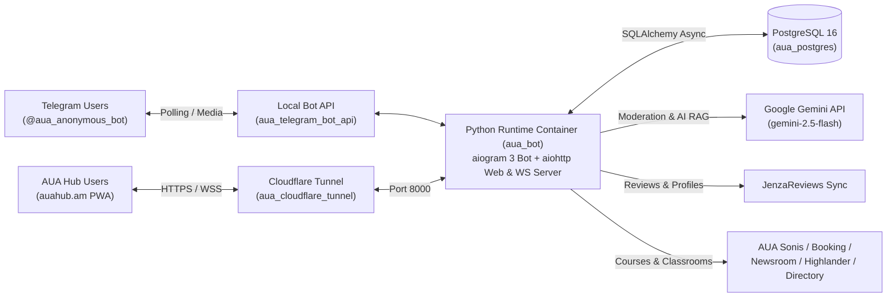

<div align="center">

# AUA Hub & Anonymous AUA Bot

**All-in-One Campus Ecosystem for the American University of Armenia (`auahub.am` & `@aua_anonymous_bot`)**

[](https://www.python.org/)
[](https://docs.aiogram.dev/)
[](https://docs.aiohttp.org/)
[](https://www.postgresql.org/)
[](https://ai.google.dev/)
[](https://docs.docker.com/compose/)
[](#license--copyright)

An independent, student-engineered full-stack platform pairing **AUA Hub** (`auahub.am`) — a Progressive Web App for AUA academics, AI search, room availability, course swaps, and campus chat — with **Anonymous AUA** (`@aua_anonymous_bot`), a privacy-first Telegram matchmaking, Q&A inbox, and anonymous wall ecosystem.

[AUA Hub Web Platform](#aua-hub-web-platform-auahubam) • [Anonymous AUA Bot](#anonymous-aua-telegram-bot) • [Architecture](#architecture--system-design) • [Security & Privacy](#security-anti-abuse--privacy) • [Deployment](#deployment--setup) • [License](#license--copyright)

</div>

---

## Overview

The repository runs both platforms from a unified asynchronous Python runtime backed by **PostgreSQL 16**, **Google Gemini**, **AUA internal/public feeds**, **Local Telegram Bot API**, and **Cloudflare Tunnel**:

| Surface | Entry Point | Core Purpose |
| :--- | :--- | :--- |
| **AUA Hub Web & PWA** | `auahub.am` (`app/web/`) | Verified student portal: AI Assistant, Have-Need course swaps, course & professor feedbacks, live free classrooms, anonymous wall/inbox sync, Telegram groups directory, and real-time campus chat. |
| **Anonymous AUA Bot** | `@aua_anonymous_bot` (`app/handlers/`) | Mutual-preference anonymous 1-on-1 Telegram chat with zero-log RAM buffering, AI moderation, Q&A inbox links (`/link`), direct invites (`/invite`), and web publishing (`/post`). |
| **Admin Analytics (`/stata`)** | `/stata` (`app/web/templates/`) | Admin-restricted statistical dashboard tracking anonymous chat metrics, AI RAG usage, bot verification & safety signals, and AUA Hub web traffic. |

---

## AUA Hub Web Platform (`auahub.am`)

Served as a responsive, dark-glassmorphic **Progressive Web App (PWA)** with WebSocket support, service worker registration (`/sw.js`), and mobile-first navigation:

### Core Modules
- **✦ AI Assistant** *(Signed-In Students & Alumni Only)*
  Multi-source **Gemini (`gemini-2.5-flash`) RAG orchestrator** (`app/services/ai_agent.py`) equipped with 6 specialized campus tools:
  1. Course & Professor Feedbacks (`JenzaReviews` local mirror + `AcademicFeedback`)
  2. Global Campus Chat History (`SpamChatMessage`)
  3. Anonymous Campus Posts & Student Groups *(private Inbox DMs excluded)*
  4. AUA Newsroom Events (`newsroom.aua.am/events/`)
  5. *The Highlander* Student Magazine (`thehighlander.aua.am`)
  6. AUA Faculty/Staff Directory (`directory.aua.am`, `people.aua.am`, + web search fallback)
  - Enforces **5 prompts per session**, anonymizes student identifiers prior to synthesis, and guards API usage with global hourly/daily prompt budgets and concurrency semaphores.

- **📚 Have-Need Course Swaps**
  Browse synced official Sonis course sections (`app/services/sonis_scraper.py`), publish sections you **have** vs. **need** (`HaveNeedPost`), automatically detect reciprocal swaps, and receive in-app/email match notifications.

- **⭐ Course & Professor Feedbacks**
  Search AUA courses and instructors, read and submit anonymous or attributed student reviews (`AcademicFeedback`), and stay synchronized with partner **JenzaReviews** (`app/services/jenzareviews_sync.py`).

- **🎭 Anonymous Wall & Inbox Sync**
  Read indexed anonymous campus posts (`/post` from Telegram or web), report rule-breaking posts, and link your Telegram account via one-time `/sync` codes (`WebSyncCode`) to view and reply to anonymous `/link` Q&A messages in the browser.

- **🚪 Free Classrooms Finder**
  Live room availability across **Main Building** and **PAB** (`app/services/booking_scraper.py`) with transient 10-minute gaps between classes filtered out so students only see genuinely usable study rooms.

- **👥 Telegram Groups Directory**
  Discover, submit, update, and filter AUA student clubs, cohort chats, and study communities.

- **💬 Real-Time Campus Chat**
  WebSocket-powered (`/ws/chat`) campus lounge for lost & found, announcements, club updates, and student discussions — supporting message replies, emoji reactions, image/media uploads, unread cursors, and strict admin-only moderation of third-party messages.

### Partnered AUA Student Platforms
AUA Hub showcases and collaborates with fellow student-built AUA tools:
- **[FindAUA](https://findaua.com)** — Student meetups, study groups, and campus activities.
- **[JenzaReviews](https://jenzareviews.com)** — Student-run professor ratings and course reviews (live-synced with AUA Hub Feedbacks & AI Assistant).
- **[AUA Utils](https://chromewebstore.google.com/detail/aua-utils/echkbfkpejnpbjfmjoagfijakbnbglgp?hl=en)** — Open-source Chrome & Firefox extension enhancing AUA portals with fast course search, GenEd discovery, multi-schedule calendar building, and Google Calendar export.

---

## Anonymous AUA Telegram Bot

Built on **aiogram 3.x** with PostgreSQL persistence for state/profiles and zero-disk volatile memory buffering for chat messages:

### Key Capabilities
- **Mutual-Preference Matchmaking (`app/services/matcher.py`)**: Matches users strictly by mutual sex & orientation preferences (`Straight`, `Gay`, `Lesbian`) combined with a hidden **Priority Score (`0–100`, starting at `50`)**.
- **Anti-Cheat, Anti-Spite & Rematch Shields**: Weighted post-chat ratings (`Like +1`, `Dislike -1`, `Spam -5`, `Not from AUA -5`), configurable rematch cooldown (`REMATCH_COOLDOWN_MINUTES=20`), anti-spite detection, and `/recent` review override.
- **Native Telegram Feel**: Bidirectional reply-chain mirroring (`ChatMessageMap`), emoji reaction syncing, message edit propagation, media album grouping (`media_batcher.py`), optional delayed `typing...` indicator (`/typing`), and **15-second View-Once Media protection** (`/onetime` + `one_time_media.py`).
- **AUA Campus Bridges**:
  - `/link` — Personal anonymous Q&A inbox link (`AnonymousInbox`, `InboxMessage`, `InboxBlock`)
  - `/post` — Publish anonymous posts directly to AUA Hub
  - `/sync` — Bind your Telegram inbox & profile with `auahub.am`
  - `/invite` — Create direct 1-on-1 anonymous chat invite links (`ChatInvite`) and manage reconnect requests
- **Student Verification & Safety**: `/verify` links `@edu.aua.am` email via OTP with gender-conflict protection (`gender_detector.py`), while `LinkShield` filters phishing/spam links and `/pause` offers one-tap sleep mode.
- **High-Throughput Media & Reliability**: Supports **Local Telegram Bot API** (up to 2 GB media payloads), active-session preservation across container restarts, atomic hourly `pg_dump` backups, inactivity monitors, and daily reminders.

### Bot Commands

<details>
<summary><strong>Click to view all User & Admin commands</strong></summary>

#### Student & Community Commands
| Command | Description |
| :--- | :--- |
| `/start` | Start bot & complete/view profile setup |
| `/search` | Search for a compatible anonymous chat partner |
| `/next` | Skip to the next anonymous partner |
| `/stop` | End current chat or cancel matchmaking search |
| `/pause` | Enter sleep / paused mode so matches wait cleanly |
| `/link` | Generate & manage your personal anonymous Q&A inbox link |
| `/post` | Publish an anonymous post to the AUA Hub wall |
| `/sync` | Generate a sync code to connect your Telegram inbox with AUA Hub |
| `/invite` | Create a direct 1-on-1 anonymous chat invite link |
| `/recent` | View recent partners, adjust feedback, or report post-chat |
| `/report` | Emergency report & instant block for active chat |
| `/blocklist` | View and manage your blocked partners |
| `/preferences` | Configure matching orientation & typing indicator settings |
| `/profile` | Update sex or orientation profile |
| `/typing` | Toggle the `typing...` status indicator |
| `/onetime` | Toggle 15-second View-Once mode for media |
| `/verify` | Verify AUA student status (`@edu.aua.am`) |
| `/safety` | View privacy facts & anti-scam protections |
| `/privacy` | Read Privacy Policy & Community Rules |
| `/stats` | View community statistics & live activity |
| `/suggestion` | Send feedback/feature suggestions directly to administrators |
| `/delete_me` | Permanently delete your account & stored profile data |
| `/help` | Display command reference & quick help |
| `/cancel` | Cancel the active interactive prompt/action |

#### Admin Commands (`ADMIN_IDS`)
| Command | Description |
| :--- | :--- |
| `/stata`, `/stats` | View admin analytics summary |
| `/stats_web`, `/web_stats` | View AUA Hub web metrics summary |
| `/reports`, `/pending_reports` | Inspect pending user/moderation reports |
| `/backup` | Trigger an immediate PostgreSQL backup snapshot |
| `/block <user_id>` | Ban a user via `BanManager` |
| `/unblock <user_id>` | Lift a user ban |
| `/setsex`, `/changesex` | Override verified sex metadata when resolved by admin |

</details>

---

## Architecture & System Design



### Repository Layout

<details>
<summary><strong>Click to expand directory tree</strong></summary>

```text
Anonymous-AUA/
├── app/
│   ├── config.py                    # Pydantic settings (Bot, Web, Auth, Turnstile, AI guardrails)
│   ├── main.py                      # Entrypoint: DB init, bot polling, background workers, aiohttp web server
│   ├── database/
│   │   ├── models.py                # SQLAlchemy ORM models (Bot, Inbox, Invites, Hub Auth, Swaps, Feedback, AI, Analytics)
│   │   ├── session.py               # Async engine & session factory
│   │   ├── crud.py                  # Telegram bot, matchmaking, moderation & inbox DB operations
│   │   └── web_crud.py              # AUA Hub CRUD, swap matching, feedbacks, chat & admin analytics
│   ├── filters/
│   │   └── admin.py                 # Admin ID filter
│   ├── middlewares/
│   │   └── banned.py                # Global O(1) BanManager middleware
│   ├── keyboards/
│   │   └── inline.py                # Inline keyboards for matchmaking, reporting, inbox, preferences
│   ├── states/
│   │   └── states.py                # aiogram FSM state definitions
│   ├── handlers/
│   │   ├── start.py                 # Onboarding, profile, verification prompts & menu navigation
│   │   ├── matchmaking.py           # /search, /next, /stop, /pause, media/reply/reaction relay
│   │   ├── feedback.py              # Post-chat ratings, AI report escalation & /recent adjustments
│   │   ├── inbox.py                 # /link anonymous Q&A inbox & reply workflows
│   │   ├── invites.py               # /invite 1-on-1 chat links & reconnect requests
│   │   ├── verification.py          # /verify @edu.aua.am OTP workflow
│   │   ├── web_bridge.py            # /post and /sync Telegram <-> AUA Hub bridges
│   │   └── admin.py                 # Admin moderation, backups, stats & ban tools
│   ├── services/
│   │   ├── ai_agent.py              # AUA Hub multi-source Gemini RAG assistant (6 tools)
│   │   ├── ai_moderator.py          # Multimodal AI report evaluator + rolling ephemeral RAM buffer
│   │   ├── backup.py                # Atomic pg_dump hourly backups & retention pruning
│   │   ├── ban_manager.py           # In-memory & DB-backed ban cache
│   │   ├── booking_scraper.py       # Live Main Building & PAB free classroom scraper
│   │   ├── daily_reminders.py       # Scheduled community re-engagement worker
│   │   ├── email_verification.py    # SMTP / dev-mode university OTP & notification dispatcher
│   │   ├── gender_detector.py       # Name/profile consistency guard for verification
│   │   ├── inactivity_monitor.py    # Automated idle chat cleanup & warnings
│   │   ├── jenzareviews_sync.py     # Bidirectional JenzaReviews catalog & review sync
│   │   ├── link_shield.py           # Multi-tier anti-phishing / anti-spam link filter
│   │   ├── matcher.py               # Weighted preference & priority matchmaking engine
│   │   ├── media_batcher.py         # Album / media group debounced forwarding
│   │   ├── one_time_media.py        # 15-second View-Once self-destructing media handler
│   │   ├── rate_limiter.py          # Per-user flood protection & cooldown tracker
│   │   ├── reply_manager.py         # Bidirectional message ID mapping for replies/edits
│   │   └── sonis_scraper.py         # Official Sonis course & section catalog sync
│   └── web/
│       ├── server.py                # aiohttp REST & WebSocket API, auth, Turnstile, /stata routing
│       ├── static/                  # AUA Hub SPA (index.html, app.js, styles.css, sw.js, manifest.json, partners/)
│       └── templates/               # Admin analytics UI (stata.html, stata_gate.html, stata_denied.html, css/js)
├── tests/                           # 23 unit & integration test suites covering bot, web hub, AI & security
├── docker-compose.yml               # 4-service stack: postgres, telegram-bot-api, bot, cloudflare-tunnel
├── Dockerfile                       # Python 3.12-slim production image with postgresql-client
├── Makefile                         # Server management helpers (start, stop, logs, update, backup, restore)
├── requirements.txt                 # Core Python dependencies
├── .env.example                     # Configuration template (no secrets committed)
├── PRIVACY.md                       # Privacy Policy & Mutual AI Code of Conduct
└── LICENSE                          # Proprietary All Rights Reserved License
```

</details>

---

## Security, Anti-Abuse & Privacy

Detailed behavioral and moderation rules are published in [`PRIVACY.md`](PRIVACY.md).

- **Authentication & Email Flood Protection**:
  - Supports **Google OAuth 2.0** (`@edu.aua.am` & `@alumni.aua.am`) and email/password + OTP verification with JWT versioning (password reset/account changes invalidate prior tokens).
  - Protected by **Cloudflare Turnstile** verification on registration, login, and password-reset flows, **per-IP sliding-window rate limiting**, and a **persistent database-backed 15-minute cooldown** (`WebEmailCooldown` / `AUTH_EMAIL_COOLDOWN_SECONDS=900`).
  - During an active cooldown, endpoints return a uniform **HTTP 200 anti-enumeration response** without sending duplicate emails while logging offending client IPs.
- **Zero-Log Anonymous Chat Ephemeral Buffer**:
  - Active 1-on-1 Telegram chats exist solely in bounded server RAM (**up to 60 text messages + 8 compressed images**) under anonymous aliases (`User_A` / `User_B`) and auto-destruct within **5 minutes** after `/stop` or `/next`.
  - When a user clicks **Report**, `ai_moderator.py` evaluates **both** participants using Gemini (`gemini-2.5-flash`) across anti-doxxing, NSFW/harassment, reporter baiting/spite reporting, and Tier-3 illegal content escalation, purging the RAM buffer immediately afterward.
- **Role & Access Guardrails**:
  - **AI Assistant** requires an authenticated student/alumni session.
  - **Campus Chat** third-party message deletion and **`/stata` analytics** are restricted strictly to authorized admin credentials (`gor_sargsyan@edu.aua.am`).

---

## Deployment & Setup

### Prerequisites
- Docker & Docker Compose
- A Telegram bot token from `@BotFather` (plus `TELEGRAM_API_ID` & `TELEGRAM_API_HASH` from `my.telegram.org` for Local Bot API)
- PostgreSQL credentials, optional SMTP credentials, Google OAuth credentials, Gemini API key, Cloudflare Tunnel / Turnstile keys (see `.env.example`)

### Quick Start

```bash
# 1. Initialize .env from template and fill in your credentials
make init

# 2. Build and launch all 4 services (postgres, telegram-bot-api, bot, cloudflare-tunnel)
make start

# 3. Check container health and view logs
make status
make logs-bot
```

### Key Configuration Variables (`.env.example`)

| Group | Variables |
| :--- | :--- |
| **Telegram & Bot** | `BOT_TOKEN`, `ADMIN_IDS`, `TELEGRAM_API_ID`, `TELEGRAM_API_HASH`, `TELEGRAM_BOT_API_URL` |
| **PostgreSQL** | `POSTGRES_USER`, `POSTGRES_PASSWORD`, `POSTGRES_DB`, `POSTGRES_HOST`, `POSTGRES_PORT` |
| **Gemini AI & Budgets** | `GEMINI_API_KEY`, `AI_GLOBAL_HOURLY_PROMPT_LIMIT`, `AI_GLOBAL_DAILY_PROMPT_LIMIT`, `AI_MAX_CONCURRENT_GEMINI_CALLS` |
| **AUA Hub Web & Auth** | `WEB_PORT`, `WEB_JWT_SECRET`, `GOOGLE_CLIENT_ID`, `GOOGLE_CLIENT_SECRET`, `GOOGLE_REDIRECT_URI` |
| **Security & Cooldowns** | `TURNSTILE_SITE_KEY`, `TURNSTILE_SECRET_KEY`, `AUTH_EMAIL_COOLDOWN_SECONDS`, `REMATCH_COOLDOWN_MINUTES` |
| **Email & Scrapers** | `SMTP_HOST`, `SMTP_PORT`, `SMTP_USER`, `SMTP_PASSWORD`, `SMTP_FROM_EMAIL`, `BOOKING_AUA_USER`, `BOOKING_AUA_PASS` |
| **External Integrations** | `CLOUDFLARE_TUNNEL_TOKEN`, `DATABASE_URL` *(JenzaReviews sync)*, `SUPABASE_URL` |

### Backups, Maintenance & Tests

```bash
# Trigger an instant atomic database snapshot (automated hourly snapshots also run in-app)
make backup

# Restore from latest snapshot (adjust user/db to match your .env)
gunzip -c backups/latest.sql.gz | docker exec -i aua_postgres psql -U aua_user -d aua_chat_db

# Open interactive PostgreSQL shell
make db-shell

# Run the automated test suite inside the running bot container
docker exec aua_bot python -m unittest discover -s tests -p "test_*.py" -v
```

---

## License & Copyright

**PROPRIETARY LICENSE — ALL RIGHTS RESERVED**

**Copyright © 2026 Gor Sargsyan. All Rights Reserved.**

See [`LICENSE`](LICENSE) for the full legal terms. Viewing the source code in this repository grants **no license, title, or permission** of any kind. Without the prior, express, written permission signed by **Gor Sargsyan**, you may **NOT**:

- Copy, clone for reuse/deployment, mirror, or reproduce this project or any file within it;
- Modify, adapt, rebrand, restyle, translate, refactor, or create **derivative works** — **even with minor, cosmetic, or substantial modifications**;
- Host, distribute, sublicense, publish, or operate any replica or modified instance for personal, academic, or commercial use.

All unauthorized copying, modified ("copy-paste with changes") redistribution, or deployment is strictly prohibited.
