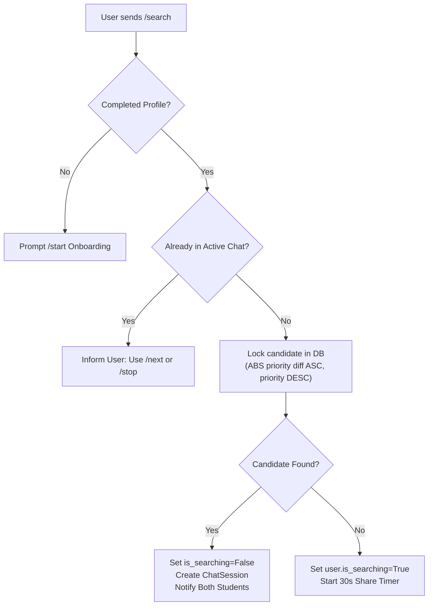
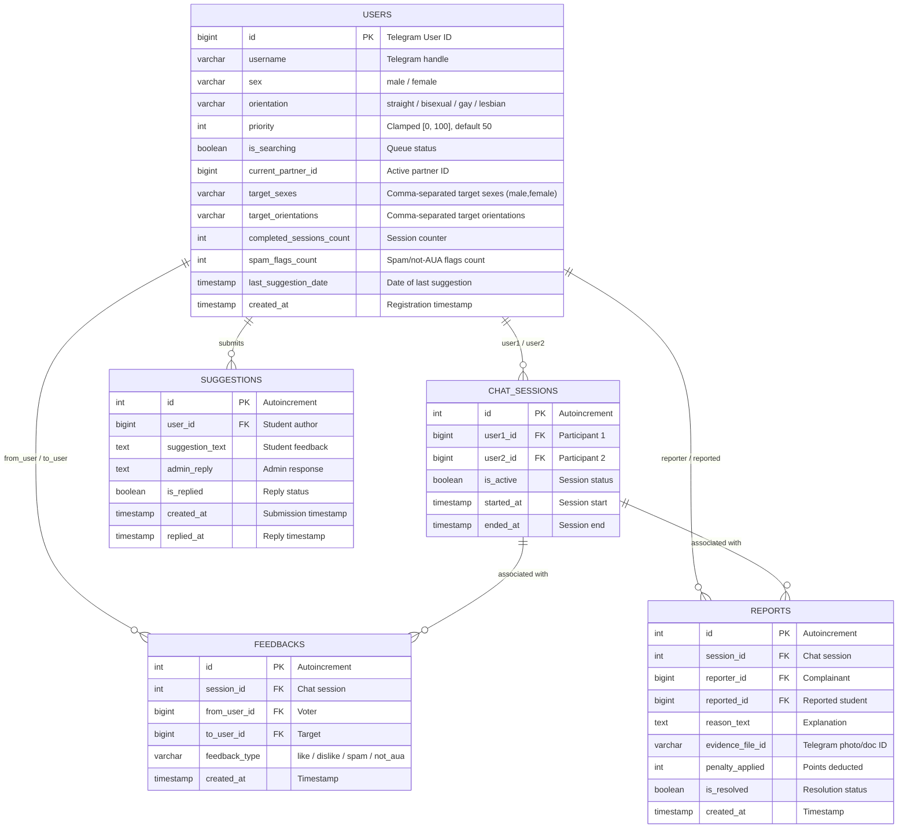

# 🎭 Anonymous AUA Telegram Chat Bot 🥷

[](https://www.python.org/)
[](https://docs.aiogram.dev/)
[](https://www.sqlalchemy.org/)
[](https://www.postgresql.org/)
[](https://www.docker.com/)

An asynchronous, production-ready Telegram bot created exclusively for students of the **American University of Armenia (AUA)**. It enables students to connect anonymously, make genuine friends, build meaningful connections, and find love based on sex, sexual orientation, and an automated reputation scoring system.

---

## 🌟 Table of Contents
- [🎯 Purpose & Vision](#-purpose--vision)
- [⚡ Key Features](#-key-features)
- [🧩 How It Works](#-how-it-works)
  - [1. Onboarding & Preferences](#1-onboarding--preferences)
  - [2. Matchmaking Algorithm](#2-matchmaking-algorithm)
  - [3. Anonymous Media & Message Relay](#3-anonymous-media--message-relay)
  - [4. Reputation & Feedback (Under the Hood)](#4-reputation--feedback-under-the-hood)
  - [5. Continuous Feedback & Admin Replies](#5-continuous-feedback--admin-replies)
- [📋 Bot Commands Reference](#-bot-commands-reference)
- [🏗️ Project Architecture](#️-project-architecture)
- [💾 Database Models & Schema](#-database-models--schema)
- [🗄️ Automated Database Backups & Recovery](#️-automated-database-backups--recovery)
- [🚀 Quickstart & Deployment](#-quickstart--deployment)
  - [Prerequisites](#prerequisites)
  - [1. Clone Repository](#1-clone-repository)
  - [2. Configure Environment](#2-configure-environment)
  - [3. Run with Docker Compose](#3-run-with-docker-compose)
  - [4. Run in Local/WSL Environment](#4-run-in-localwsl-environment)
- [🛡️ Moderation & Administrator Tools](#️-moderation--administrator-tools)
- [📄 License](#-license)

---

## 🎯 Purpose & Vision

University life is filled with incredible people, yet meeting compatible peers outside one's major or cohort can be intimidating. **Anonymous AUA** breaks down social barriers by offering a safe, respectful, and anonymous environment for AUA students to:
- 💬 Chat honestly without fear of judgment.
- 🤝 Make new campus friends across different faculties (BS, CS, BAB, EC, LL.M, etc.).
- ❤️ Discover romantic connections tailored to sex and sexual orientation.
- 🛡️ Enjoy a well-moderated platform that actively penalizes spam, abuse, and non-AUA intruders.

---

## ⚡ Key Features

- **Compatibility Matrix & Mutual Matching Preferences**: Pairs students based on mutual criteria. By default, preferences target romantic partners, but students can customize who they want to connect with (Male, Female, Straight, Bisexual, Lesbian, Gay) via interactive checkbox menus.
- **Custom Matching Preferences (`/preferences`)**: Interactive inline checkboxes allow users to talk to any sex and orientation without LGBT flags in the menu. Matches only occur when **both** students' preferences mutually match.
- **Bisexual Compatibility Engine**: Seamlessly matches bisexual students with compatible opposite-sex partners (straight or bisexual) or same-sex partners (gay/lesbian or bisexual).
- **Hidden Priority Matchmaking**: Uses row-level database locking (`with_for_update(skip_locked=True)`) to pair users with the closest reputation score (`ABS(candidate.priority - user.priority) ASC`), ensuring high-quality users match with each other. The priority score is kept invisible to students to prevent gamification.
- **Full Media Relay, Native Replies, Emoji Reactions & Edit Sync**: Intercepts and anonymously forwards text, photos, voice messages, stickers, video notes, and documents using Telegram's native `copy_to` API.
- **Native Telegram Reply Support**: Students can swipe right or tap **Reply** on any message. The bot dynamically translates message IDs between the two private chats and delivers replies with native Telegram quote bubbles pointing to the partner's exact message (supports partner replies and self-quotes).
- **Emoji Reactions Mirroring**: When a student reacts with an emoji (e.g. 👍, ❤️, 🔥, 😂) to a message or removes a reaction, the bot listens to `MessageReactionUpdated` and instantly mirrors the exact reaction onto the partner's corresponding message via `set_message_reaction`.
- **Live Edited Messages Synchronization**: When a student edits a message (text or media caption) in their chat, the bot catches the update and immediately edits the corresponding message in the partner's chat in real-time, preserving rich text formatting and entities.
- **Natural Typing Indicator Emulation (`typing...`)**:
  - Emulates realistic human typing on the bot's header bar via Telegram's `sendChatAction` API (`typing`, `upload_photo`, `record_voice`, `upload_video`, `upload_document`), scaled naturally to message length.
  - Features strict per-user FIFO concurrency locking to guarantee in-order message delivery.
  - **Privacy Toggle**: Enabled by default, but users who prefer stealth can toggle it off anytime via `/preferences` or the `/typing` command.
- **Emergency In-Chat Reporting & Evidence Review (`/report`)**:
  - In-chat `/report` command providing a 1-click panic button (`🚨 Emergency Disconnect & Report`) that severs uncomfortable chats, auto-blocks the abuser, and accepts text or photo/screenshot evidence.
  - Fail-safe reporting: captures user feedback immediately upon clicking Report, with automatic session recovery and auto-forwarding of screenshot evidence to administrators.
- **Anti-Phishing & Anti-IPLogger Shield**: Automatically inspects relayed messages for external links (`http://`, `https://`, `t.me/`, `iplogger`, `grabify`, `bit.ly`) and displays an immediate security warning banner protecting students from phishing and IP loggers.
- **Privacy & Anti-Blackmail Protection (`/safety`)**: Provides verifiable technical facts explaining that Telegram bots cannot expose avatars, phone numbers, or IP addresses, actively countering intimidation and extortion bluffs.
- **Smart Engagement Engine**:
  - Automatically notifies users after 30 seconds of searching, explaining that the bot is new and inviting them to share the bot link with classmates.
  - Prompts students for bot improvement ideas after every 2 completed sessions (throttled to at most once per day).
- **Direct Admin Feedback & Two-Way Replies**: Users can send suggestions via `/suggestion` or the feedback prompt. Admins receive instant notifications and can reply directly to the student in Telegram.
- **Admin Supervision & Dashboards**:
  - `/stata` live real-time statistics dashboard (registrations, active chats, orientation breakdowns, feedbacks, reports, suggestions).
  - One-click report moderation with customizable penalty deduction (`0` to `100` clamping).
- **Production-Grade Dockerization**: Lightweight Python 3.12-slim image coordinated with PostgreSQL 16 Alpine via `docker-compose.yml` featuring healthchecks and persistent volumes.

---

## 🧩 How It Works

### 1. Onboarding & Preferences
1. A new student sends `/start`.
2. The bot presents inline buttons to select **Sex** (`👨 Male` / `👩 Female`).
3. Next, the student selects **Sexual Orientation** (`👫 Straight` / `🌈 Bisexual` / `👭 Lesbian` / `👬 Gay`).
4. **Interactive Preferences Stage**: The bot sets romantic defaults, then displays clean inline checkboxes (no LGBT flags) for:
   - Sexes: `Male`, `Female`
   - Orientations: `Straight`, `Bisexual`, `Lesbian`, `Gay`
   Students can customize whom they want to connect with and press `💾 Save Preferences`.
5. Students can re-adjust their preferences at any time using the `/preferences` command.
6. The student is registered with a default priority of `50/100` (kept internal).

**Default Romantic Preferences:**
- `Straight Male`: Female (`Straight`, `Bisexual`)
- `Straight Female`: Male (`Straight`, `Bisexual`)
- `Gay Male`: Male (`Gay`, `Bisexual`)
- `Lesbian Female`: Female (`Lesbian`, `Bisexual`)
- `Bisexual Male`: Female (`Straight`, `Bisexual`) AND Male (`Gay`, `Bisexual`, `Straight`)
- `Bisexual Female`: Male (`Straight`, `Bisexual`) AND Female (`Lesbian`, `Bisexual`, `Straight`)

**Mutual Matching Rule:**
Matchmaking connects User A and User B **if and only if both users' criteria match each other**:
- User B's sex is in User A's target sexes AND User B's orientation is in User A's target orientations.
- User A's sex is in User B's target sexes AND User A's orientation is in User B's target orientations.

### 2. Matchmaking Algorithm
When a student sends `/search` (or `/next`):


### 3. Anonymous Media, Message Relay, Native Replies, Reactions & Edits
Once connected, any message sent by either student (text, photo, voice note, round video, sticker) is stripped of sender identity and cleanly copied to the partner's chat.

- **Native Telegram Replies**:
  - When a student swipes right or taps **Reply** on any message, the bot matches the corresponding message ID in the partner's chat and delivers the response with a native Telegram quote bubble.
  - Supports replying to the partner's messages as well as self-quoting previous messages.
  - Features graceful fallbacks (`allow_sending_without_reply=True`) so messages are always reliably delivered even if a quoted message was deleted.
- **Emoji Reactions Mirroring**:
  - Supports live Telegram emoji reactions (👍, ❤️, 🔥, 😂, etc.).
  - When a user adds, modifies, or removes a reaction on any message in their chat with the bot, the bot automatically finds the partner's corresponding message and updates the reaction in real-time.
- **Live Edited Messages Synchronization**:
  - When a student edits any previously sent text or media caption in their chat, the bot intercepts the edit and immediately applies it to the corresponding message in the partner's chat via `edit_message_text` or `edit_message_caption`.
  - Preserves formatting entities (bold, italic, links, code blocks) and handles non-modified edits smoothly.
- **Privacy & Memory Safety**:
  - Mappings are held in a bounded in-memory FIFO cache (`ReplyManager`, up to 400 messages per conversation). No message text or contents are ever stored in the database.
  - Mappings are automatically purged when the chat session ends (`/stop`, `/next`, or disconnect).

If either user blocks the bot or leaves, the session automatically terminates, and both participants receive a prompt to rate the conversation.

### 4. Anti-Spite Reputation & Feedback System (Under the Hood)
To eliminate malicious retaliation ("spite voting" where an angry user clicks "Spam" just because they disliked the chat), the platform enforces a 3-layer protection system:

1. **Streamlined 2-Tier UI**:
   - **Tier 1 (Primary Prompt)**: Clean binary feedback `[👍 Great Chat]` and `[👎 Not for me]`, plus a discreet `[⚠️ Report Issue...]` button. 95% of casual users who simply didn't vibe with a partner click `👎 Not for me`.
   - **Tier 2 (Issue Categories)**: Tapping `[⚠️ Report Issue...]` opens specific moderation categories: `[🚫 Spam / Promo]`, `[🏫 Not from AUA]`, `[🚨 Harassment / Other]`, and `[🔙 Back]`.
2. **Chat Duration Filter (< 15 seconds)**:
   - If a conversation ends in **under 15 seconds**, any negative rating (`Dislike`, `Spam`, `Not AUA`) is treated as a neutral quick skip (**0 penalty delta applied**), preventing users who rage-quit after 3 seconds from docking peer reputation points.
3. **Consensus-Based Penalties (Corroboration Required)**:
   - **1st Report**: Only applies a base `-1` penalty (or 0 if < 15s). A single hater **cannot** heavily harm an innocent user.
   - **2nd Report (Consensus Reached)**: When $\ge 2$ independent students report the same user, the system confirms a pattern, applies an additional `-4` penalty (**-5 total penalty**), and broadcasts an automated high-priority alert to all administrators.
   - **Repeat Offenders (3+ Reports)**: Subsequent independent flags apply immediate `-5` penalties and alert admins.

> **Note:** Priority scores and point modifiers remain completely invisible to students. The system operates autonomously in the database, ensuring well-behaved students enjoy faster and better matches.

### 5. Continuous Feedback & Admin Replies
1. **Periodic Prompts:** Every 2 completed sessions, students receive an optional prompt with `[💡 Give suggestions]` and `[✖️ Dismiss]`.
2. **One-Per-Day Throttling:** Once a student sends a suggestion, they won't be prompted again for the rest of the calendar day.
3. **On-Demand:** Any user can type `/suggestion` at any time.
4. **Two-Way Thread:** Admins receive the student's idea with an `[✍️ Reply to Student]` button. When pressed, the admin types a reply, and the bot delivers it directly back to the student.

---

## 📋 Bot Commands Reference

| Command | Audience | Description |
| :--- | :---: | :--- |
| `/start` | Public | Initiates the onboarding profile setup or displays welcome menu. |
| `/help` | Public | Displays reference guide and summary of all available bot commands. |
| `/search` | Public | Enters the matchmaking queue to find an anonymous student partner. |
| `/next` | Public | Ends the current conversation and immediately queues for a new partner. |
| `/stop` | Public | Ends an active chat session or cancels a pending search. |
| `/report` | Public | Emergency shield: severs chat, auto-blocks partner, and accepts text/screenshot evidence. |
| `/safety` | Public | Displays privacy facts, anti-blackmail advice, and debunking of IP/avatar leak myths. |
| `/preferences` | Public | Adjusts target sexes, orientations, and typing indicator via checkbox menu. |
| `/typing` | Public | Quickly toggles typing status indicator on/off (stealth mode). |
| `/blocklist` | Public | Displays blocked partners as date buttons with `[<] [2/3] [>]` pagination to unblock. |
| `/stats` (or `/stata`) | Public | Shows community metrics: registered count, active chats, male/female, and orientations. |
| `/profile` | Public | Resets and reconfigures sex and sexual orientation. |
| `/suggestion` | Public | Sends feedback, feature requests, or bug reports to admins. |
| `/cancel` | Public | Aborts any active prompt or input without ending active chat. |
| `/stata` | **Admins Only** | Displays full administrator dashboard (backups, feedbacks, reports, suggestions). |
| `/backup` | **Admins Only** | Triggers an immediate on-demand database backup and gzipped SQL snapshot. |
| `/block <user_id>` | **Admins Only** | Permanently bans a malicious user and disconnects any active chat partner. |
| `/unblock <user_id>` | **Admins Only** | Unbans a previously banned user and restores bot access. |

---

## 🏗️ Project Architecture

```
Anonymous AUA/
├── .env                         # Active environment variables (git-ignored)
├── .env.example                 # Template for environment configuration
├── .gitignore                   # Standard Python, IDE, and container exclusions
├── docker-compose.yml           # Multi-container orchestration (Bot + PostgreSQL)
├── Dockerfile                   # Python 3.12-slim production container
├── requirements.txt             # Python dependencies
├── alembic.ini                  # Alembic database migrations configuration
├── alembic/
│   ├── env.py                   # Async Alembic execution environment
│   ├── script.py.mako           # Migration template
│   └── versions/                # Version history scripts
└── app/
    ├── __init__.py
    ├── main.py                  # Entrypoint: sets up bot, dispatcher, DB tables, polling
    ├── config.py                # Pydantic Settings & environment variable validator
    ├── database/
    │   ├── __init__.py          # Model exports
    │   ├── models.py            # SQLAlchemy 2.0 models (User, ChatSession, Feedback, Report, Suggestion)
    │   ├── session.py           # AsyncEngine, AsyncSessionLocal, init_db schema migration
    │   └── crud.py              # Queries, priority clamping [0, 100], and stats aggregator
    ├── filters/
    │   ├── __init__.py
    │   └── admin.py             # IsAdminFilter checking Telegram ID against ADMIN_IDS
    ├── handlers/
    │   ├── __init__.py          # Ordered router registration
    │   ├── start.py             # /start, /preferences, /profile onboarding & /suggestion entry
    │   ├── matchmaking.py       # /search, /stop, /next & 30-second share prompt
    │   ├── feedback.py          # Session ratings, report intake, and suggestion submission
    │   └── admin.py             # /stata dashboard, report penalties, and suggestion replies
    ├── keyboards/
    │   ├── __init__.py
    │   └── inline.py            # Inline buttons for onboarding, preferences, ratings, suggestions, admin actions
    ├── services/
    │   ├── __init__.py
    │   └── matcher.py           # Mutual compatibility & row-level locked queue matcher
    └── states/
        ├── __init__.py
        └── states.py            # FSM States: Onboarding, Preferences, Reporting, AdminPenalize, Suggestion, AdminReply
```

---

## 💾 Database Models & Schema



---

## 🗄️ Automated Database Backups & Recovery

The bot includes an enterprise-grade automated backup system designed to safeguard student data, matching histories, and preferences against hardware crashes, data corruption, or accidental deletions.

### 🌟 Key Backup Features
1. **Automated Hourly Execution**: A non-blocking background async task runs inside the bot container every 60 minutes.
2. **Atomic Replacement**: Backups stream into a temporary archive (`.dump_<timestamp>.tmp.gz`), verify data integrity and non-zero size, and only then atomically replace `backups/latest.sql.gz`. A corrupted dump will **never** overwrite a healthy backup.
3. **Gzip Stream Compression**: SQL dumps are compressed on-the-fly, reducing file size by 85–90% (~6 KB per snapshot) with near-zero CPU and disk footprint.
4. **Rolling 24-Hour Archive**: In addition to `latest.sql.gz`, the system retains the last 24 timestamped snapshots (`backups/backup_YYYYMMDD_HHMMSS.sql.gz`) with automatic FIFO pruning.
5. **Strict Git & Privacy Isolation**:
   - `backups/`, `*.sql`, `*.sql.gz`, and `*.dump` are strictly declared in [`.gitignore`](file:///home/gor/Projects/Anonymous-AUA/.gitignore).
   - Sensitive student chat data, IDs, and reputation scores are **never** committed or exposed on GitHub.
6. **Admin On-Demand Snapshot (`/backup`)**: Administrators can trigger an instant snapshot anytime via Telegram before container upgrades or server maintenance.

### 🔄 How to Restore Database from Backup
To restore the PostgreSQL database from the latest snapshot:

```bash
# 1. Decompress and restore into the running PostgreSQL container:
gunzip -c backups/latest.sql.gz | docker exec -i aua_postgres psql -U bruce -d aua_chat_db

# 2. Or restore from any specific historical snapshot:
gunzip -c backups/backup_20261019_144856.sql.gz | docker exec -i aua_postgres psql -U bruce -d aua_chat_db
```

---

## 🚀 Quickstart & Deployment

### Prerequisites
- Docker Engine & Docker Compose (or WSL2 on Windows 11).
- A Telegram Bot Token from [@BotFather](https://t.me/BotFather).
- Your Telegram numeric User ID (obtain from [@userinfobot](https://t.me/userinfobot)).

### 1. Clone Repository
```bash
git clone https://github.com/your-username/anonymous-aua-bot.git
cd anonymous-aua-bot
```

### 2. Configure Environment
Create your `.env` file from the provided template:
```bash
cp .env.example .env
```
Open `.env` and fill in your values:
```env
BOT_TOKEN=64894085692:AAGwehjfvbwjehbfc-HGdvwEJHVFw16KfpgvtQAVU
ADMIN_IDS=458432154653

POSTGRES_USER=aua_user
POSTGRES_PASSWORD=aua_secure_password_here
POSTGRES_DB=aua_chat_db
POSTGRES_HOST=postgres
POSTGRES_PORT=5432
```

### 3. One-Command Server Start (with Automatic Restart)
Using the included `Makefile`:
```bash
# Start bot and database in background
make start
```

### 4. Enable Autostart on Server Reboot
To ensure the bot always starts automatically whenever your server or computer boots up / restarts:
```bash
# Configures Linux systemd service & enables Docker autostart on boot
make autostart
```

### 5. Makefile Server Management Commands
| Command | Action |
| :--- | :--- |
| `make start` | Builds and runs containers in the background with auto-restart |
| `make autostart` | Configures system-level service so bot auto-starts on computer reboot |
| `make logs-bot` | Streams live bot logs |
| `make logs` | Streams all service logs (bot + database) |
| `make status` | Displays container status and health |
| `make restart` | Restarts all containers |
| `make stop` | Stops and tears down containers |
| `make update` | Pulls latest git updates and rebuilds containers |
| `make db-shell` | Opens interactive PostgreSQL terminal |

---

### Alternative: Direct Docker Compose Commands
If you prefer running Docker Compose directly:
```bash
# Start containers
docker compose up -d --build

# View logs
docker compose logs -f bot

# Stop containers
docker compose down
```

### Alternative: Run in Local/WSL Environment (Without Docker)

If running without Docker:
```bash
# 1. Start local PostgreSQL
sudo service postgresql start

# 2. Set up virtual environment
python3 -m venv .venv
source .venv/bin/activate

# 3. Install dependencies
pip install -r requirements.txt

# 4. Start the application
python3 -m app.main
```

---

## 🛡️ Moderation & Administrator Tools

### Real-Time Statistics (`/stata`)
Admins can send `/stata` to view an aggregated dashboard:
```text
📊 Anonymous AUA — Administrator Dashboard 🎭
━━━━━━━━━━━━━━━━━━━━━━━━━━━━
👥 User Base:
• Total Registered: 142
• Actively Searching: 3
• Active Chats: 8

🚻 Sex Breakdown:
• Male: 78
• Female: 64
• Unfinished Setup: 0

🧭 Orientation Breakdown:
• Straight: 118
• Bisexual: 22
• Lesbian: 14
• Gay: 10

⭐ All-Time Feedbacks:
• 👍 Likes: 312
• 👎 Dislikes: 18
• 🚫 Spams: 4
• 🏫 Not from AUA: 2

💡 Bot Suggestions:
• Total Received: 15
• ✅ Replied: 12
• ⏳ Pending: 3

🚨 Reports Summary:
• Total Filed: 5
• ✅ Resolved: 4
• ⏳ Pending: 1

💾 Database Backups:
✅ Active (2026-10-19 14:48:56 UTC)
• Primary File: backups/latest.sql.gz (5.9 KB)
• Rolling Snapshots: 1
━━━━━━━━━━━━━━━━━━━━━━━━━━━━
```

### On-Demand Database Backup (`/backup`)
Admins can send `/backup` at any time to immediately export and compress a clean SQL dump of the database:
```text
💾 PostgreSQL Database Backup Created Successfully! 🛡️
━━━━━━━━━━━━━━━━━━━━━━━━━━━━
📁 Primary: backups/latest.sql.gz
📦 Archive Snapshot: backup_20261019_144856.sql.gz
📊 Snapshot Size: 5.86 KB
🗂 Total Rolling Snapshots: 1
🕒 Timestamp: 2026-10-19 14:48:56 UTC
🔒 Security: Strict 0644 / Git-ignored / Isolated
━━━━━━━━━━━━━━━━━━━━━━━━━━━━
```

### Handling User Reports & Security Incidents
When a student submits a report (via `/report` during chat or `⚠️ Report Issue...` after chat):
1. **Automated Protection**: The reported user is immediately and permanently blocked from the reporter's matchmaking queue.
2. **Urgent Keyword Escalation**: Reports containing critical terms (`blackmail`, `threat`, `leak`, `nude`, `dox`, `money`, `scam`) trigger an instant **`🚨 URGENT: CRITICAL REPORT ALERT`** to all administrators.
3. **Evidence Forwarding**: If the student attaches a screenshot, photo, document, voice note, or video, the bot forwards the file directly to all admins alongside the report card.
4. **Admin Moderation Actions**:
   - `[⚖️ Penalize User]`: Prompts admin for the number of reputation points to deduct (e.g., `15`). The user's priority is reduced (clamped at minimum `0`), and the report is marked resolved.
   - `[🚫 Ban User]`: Permanently bans the offender via `/block <user_id>`.
   - `[✅ Dismiss]`: Resolves the report with `0` penalty.


---

## 📄 License
Distributed under the MIT License. See `LICENSE` for more information. Built with ❤️ for the American University of Armenia student community.
